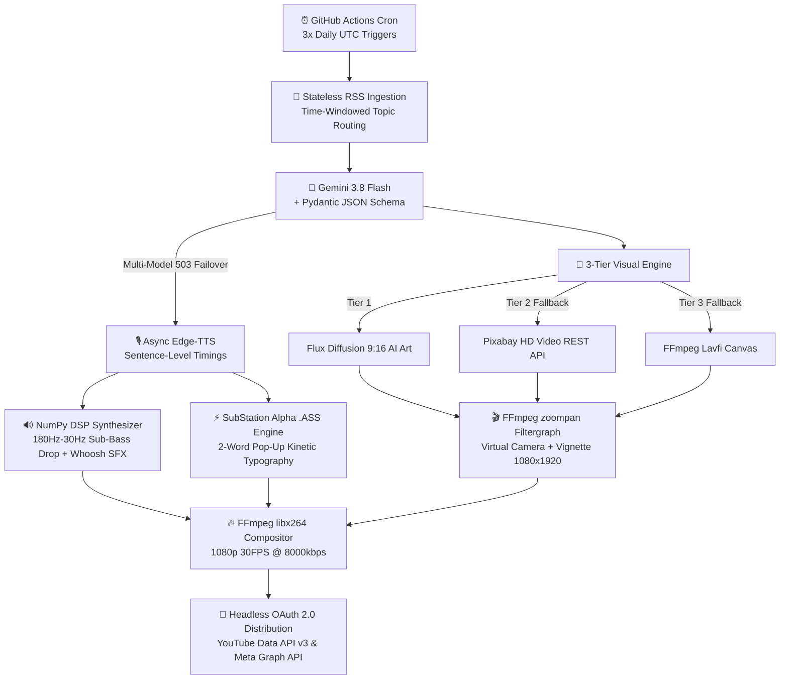

# 🚀 Autonomous Multi-Modal AI Video Generation & Distribution Pipeline


An end-to-end, **zero-marginal-cost ($0/month)** cloud-native media pipeline that autonomously ingests real-time breaking tech news, orchestrates LLMs with deterministic schema validation, synthesizes neural speech and procedural sound effects via Digital Signal Processing (DSP), renders 1080p 9:16 vertical videos with kinetic typography, and schedules peak-hour uploads to **YouTube Shorts** and **Instagram Reels** 3x daily.

---

## 🏗️ System Architecture



---

## ✨ Key Engineering Highlights

### 1. Deterministic LLM Orchestration (`google-genai` + `Pydantic`)
* Enforces strict **Pydantic (`BaseModel`)** response schemas on **Gemini 3.8 Flash**, guaranteeing structured JSON outputs containing SEO metadata, hook badges, time-constrained scripts (`<75 words` for strict `<60s` YouTube Shorts compliance), and visual prompts.
* Features an **automated multi-model failover loop** that dynamically queries `client.models.list()` to recover from `503 UNAVAILABLE` traffic spikes.

### 2. Procedural DSP Audio Synthesis (`NumPy` + `wave`)
* Eliminates external audio dependencies and copyright risks by synthesizing a **44.1kHz 16-bit PCM soundtrack** directly in memory using `NumPy`:
  * **Pattern-Interrupt Sub-Bass Drop:** Exponential frequency sweep (`180Hz → 30Hz` over `2.5s`) with harmonic wave-clipping distortion at `t = 0.0s`.
  * **Ambient Drone:** Continuous `45Hz` and `90Hz` dual-oscillator dark background pulse.
  * **Frame-Synced Whoosh Transitions:** Calculates cumulative scene durations (`np.cumsum`) and injects sine-enveloped Gaussian noise sweeps at every visual cut.

### 3. Programmatic Video Compositing & Kinetic Typography (`FFmpeg` + `libass`)
* **Virtual Camera Kinematics:** Applies FFmpeg `zoompan` filtergraphs (`s=1080x1920`, `fps=30`) with radial `vignette` shading to transform static diffusion generations into dynamic documentary scenes.
* **Vector Pop-Up Subtitles (`.ass`):** Generates character-weighted timestamps for 2-word chunks and injects SubStation Alpha override tags (`\fscx135\fscy135\t(0,100,\fscx100\fscy100)`) for 135%-to-100% bounce scaling and dynamic BGR hex color highlighting.

### 4. 3-Tier Self-Healing Visual Failover
* **Tier 1:** Requests custom 1080x1920 vertical AI visuals via Flux Diffusion with browser `User-Agent` spoofing and byte-length verification (`>30KB`).
* **Tier 2:** Automatically falls back to the **Pixabay Video REST API** if datacenter IPs are rate-limited.
* **Tier 3:** Generates a procedural `lavfi` canvas to guarantee zero pipeline crashes.

### 5. Stateless Topic Deduplication & Headless OAuth 2.0
* Prevents duplicate news coverage across stateless CI/CD runs via **UTC Time-Slotted Sub-Niche Routing** (*Morning: LLMs & Tech Giants | Afternoon: Robotics & Silicon | Evening: Cybersecurity & Breakthroughs*).
* Authenticates in headless Linux containers via sanitized **OAuth 2.0 Refresh Token rotation** and schedules uploads for peak viewership windows (`12:00 PM`, `05:30 PM`, and `09:00 PM IST`).

---

## 💰 Unit Economics (SaaS Cost Comparison)

| Component | Traditional Creator Stack | This Pipeline | Monthly Cost |
| :--- | :--- | :--- | :--- |
| **LLM Scripting** | OpenAI API / ChatGPT Plus | Gemini 3.8 Flash (Free Tier) | **$0.00** |
| **Voiceover (TTS)** | ElevenLabs ($22/mo) | Microsoft `edge-tts` Neural | **$0.00** |
| **Visuals & B-Roll** | Midjourney ($30/mo) | Flux API + Pixabay Fallback | **$0.00** |
| **Video Rendering** | Creatomate / Shotstack ($49/mo) | Custom `FFmpeg` + `.ass` Engine | **$0.00** |
| **Cloud Compute** | AWS EC2 / Zapier ($20/mo) | GitHub Actions Cron CI/CD | **$0.00** |
| **Total Monthly COGS** | **~$121.00 / month** | **100% Open-Source / Free Tier** | **$0.00 / mo** |

---

## ⚙️ Repository Structure & Deployment

```text
├── .github/
│   └── workflows/
│       └── daily_short.yml   # Serverless CI/CD cron workflow (3x daily)
├── bot.py                    # Core multi-modal generation & upload engine
└── README.md                 # System documentation
```

### Required GitHub Actions Secrets
Configure under **Settings → Secrets and variables → Actions → Repository secrets**:
* `GEMINI_API_KEY` – Google AI Studio API Key
* `PIXABAY_API_KEY` – Pixabay REST API Key
* `YT_CLIENT_ID` – Google Cloud OAuth 2.0 Client ID
* `YT_CLIENT_SECRET` – Google Cloud OAuth 2.0 Client Secret
* `YT_REFRESH_TOKEN` – Permanent Headless OAuth 2.0 Refresh Token
